<div align="center">
  

  

  <br/>

  

  <p><b>📍 Current Location:</b> Dark Forest Garden 🌿 &nbsp;|&nbsp; <b>🧬 Class:</b> Full-Stack Shadow Walker &nbsp;|&nbsp; <b>🪐 Home world:</b> Planet Zzznai</p>

  
</div>

---

## 🛰️ Mission Control

```kotlin
object Zzznai : Explorer {
    override val homeWorld = "Planet Zzznai"
    override val mainWeapons = listOf("C#", ".NET", "JavaScript", "C++")
    override val nowLearning = listOf("Kotlin", "Android", "Room", "MVVM")
    override val fuel = "☕ coffee + curiosity"

    override fun dailyRoutine() {
        while (universe.isExpanding()) {
            learn(); build(); commit(); repeat()
        }
    }
}
```

---

## 📜 Shadow Quest Journal
| Status | Quest | XP Reward |
| :--- | :--- | :--- |
| 🟣 **New** | **Android Awakening** - Ship a Kotlin app with Room, camera & sensors | +1000 XP |
| 🟡 **Active** | **Deep C# Mastery** - Unlock Memory Management | +750 XP |
| 🟢 **Clear** | **Proper Logic** - Fixed External Resource Errors | +300 XP |
| ⚪ **Locked** | **The Open Source Key** - Merge a Foreign PR | ??? |

---

## 🛠️ Dark Inventory & Skill Tree
### ⚔️ Primary Weapons
- **C# / .NET** `Level 25` ████████░░
- **JavaScript** `Level 20` ██████░░░░
- **C++** `Level 15` ████░░░░░░
- **Kotlin / Android** `Level 3` █░░░░░░░░░ `✨ new spell unlocked`

### 🎒 Utility Belt
<p align="left">
  
  
  
  
  
  
  
  
  
</p>

---

## 📊 Global Leaderboard
<div align="center">
  
</div>

---

## 💬 NPC Dialogue Box
> **Zzznai says:** "I'm looking to collaborate on any project that encourages learning! Drop a scroll at **naimabazabaz@gmail.com** if you want to party up."

<div align="center">
  

  <sub>✦ 0101 · thanks for visiting Planet Zzznai · 1010 ✦</sub>

  
</div>
