# Hi, I'm Naim Abaz

**Software Engineering student · C# / Python / Assembly · Data Analysis, Machine Learning & AI**

---

### About me

I'm a software engineering student who enjoys understanding how things work, from high-level application code down to what the CPU actually executes.

- **Languages I focus on:** C#, Python and Assembly
- **Interested in:** data analysis, machine learning and artificial intelligence
- **Currently learning:** Android development with Kotlin, and Python for data work
- **Open to:** collaborating on learning-oriented and data-driven projects

---

### Tech stack

  
  
  
  
  
  
  
  
  

**Exploring for data & AI:**

---

### Selected projects

| Project | Description | Tech |
| :--- | :--- | :--- |
| [Bambi](https://github.com/Zzznai/Bambi) | Web platform for exchanging and selling second-hand clothes | JavaScript |
| [MusicCatalog](https://github.com/Zzznai/MusicCatalog) | Music catalog application | C# |
| [E-Pharmacy](https://github.com/Zzznai/E-Pharmacy) | Online pharmacy web application | JavaScript |
| [BarRating](https://github.com/Zzznai/BarRating) | Bar rating system, state exam practical task | C# |
| [Pet-Clinic](https://github.com/Zzznai/Pet-Clinic) | .NET application built during my internship | C# / .NET |
| [FireAlarmSystem](https://github.com/Zzznai/FireAlarmSystem) | Arduino-based fire alarm system | C++ |

---

### GitHub statistics

  
  
  
   
  
    
  
    
  

---

### Contact

📫 **naimabazabaz@gmail.com**
